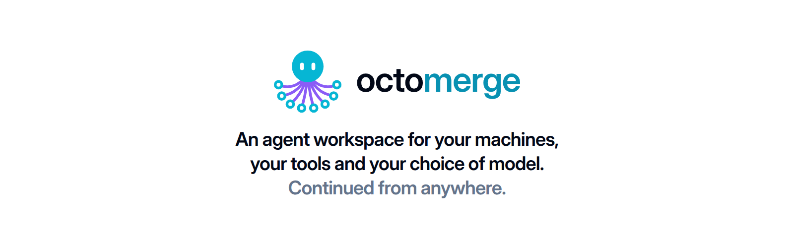

  <picture>
    <source media="(prefers-color-scheme: dark)" srcset="banner-dark.png">
    
  </picture>

Octomerge is an agent workspace in the cloud. Configure your agents once and run them on any machine you connect, with the models you already pay for, mixing providers in one conversation. Follow and steer every session from a phone, another laptop or the terminal.

- **Get started:** [octomerge.dev](https://octomerge.dev)
- **Read the manual:** [docs.octomerge.dev](https://docs.octomerge.dev)
- **Report a problem or suggest a feature:** [octomergehq/octomerge](https://github.com/octomergehq/octomerge/issues)

Otti, our octopus, is drawn as a git octopus merge: one commit, many parents. Otti is also the co-author of the commits Octomerge's agents help write, as [@ottibot](https://github.com/ottibot).

[X](https://x.com/octomergehq) · [LinkedIn](https://www.linkedin.com/company/octomerge) · [YouTube](https://www.youtube.com/@octomergehq) · [Instagram](https://www.instagram.com/octomerge)
